# Le style Cadence : reproduire l'habillage « verre fumé »

Ce guide sert à refaire ailleurs l'apparence, les animations et les comportements de Cadence : verre fumé sur photo,
rail à vague liquide, pastilles qui deviennent leur menu, transitions d'écran. Il réunit les valeurs exactes, les
fichiers à reprendre et, surtout, les pièges rencontrés en le construisant, avec leur correction.

Toutes les captures sont dans [`captures/`](captures/). Les séquences `seq-*.jpg` montrent une animation image par
image : le navigateur était ralenti ×10, les temps indiqués sont les temps réels.

---

## 1. L'ensemble en un coup d'œil

| | |
|---|---|
| 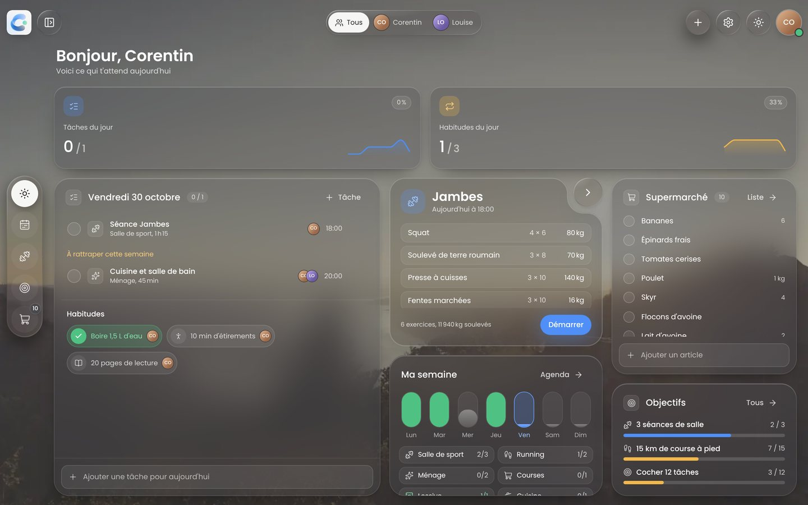 | 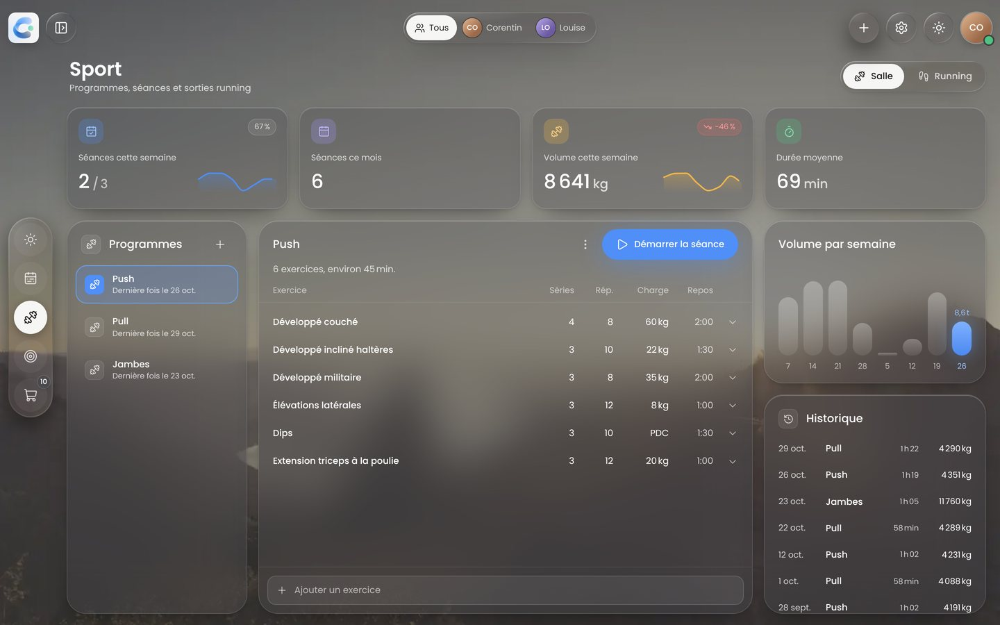 |
| Aujourd'hui : salutation, cartes KPI, panneaux de verre | Sport › Salle : KPI à icône teintée, pastille d'évolution, courbe |
| 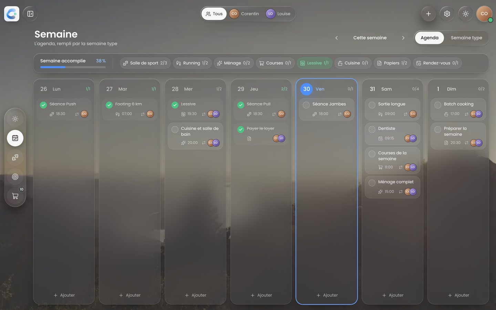 | 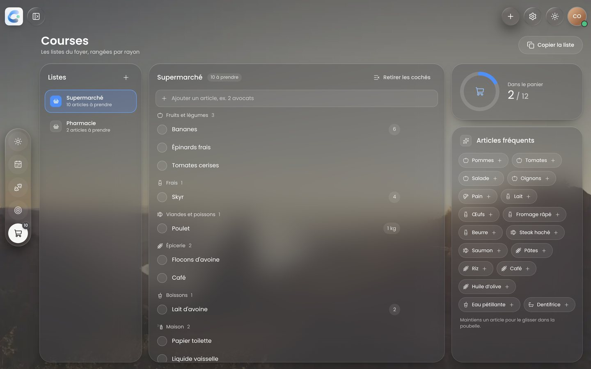 |
| Semaine : 7 colonnes de verre | Courses : le filtre des personnes s'efface (écran partagé) |
| 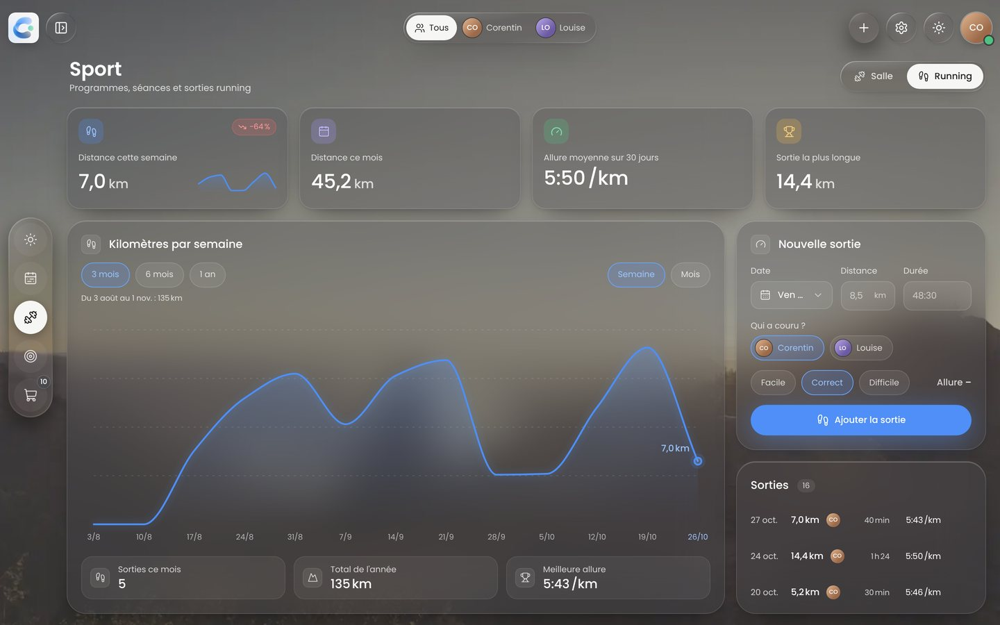 | 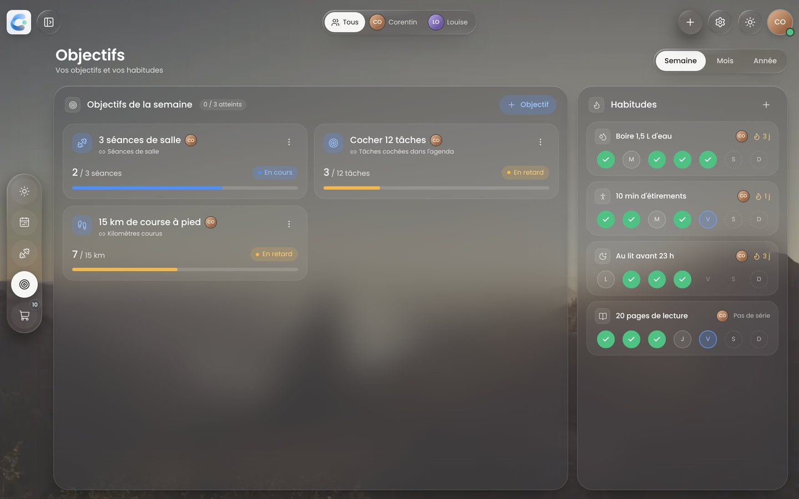 |
| 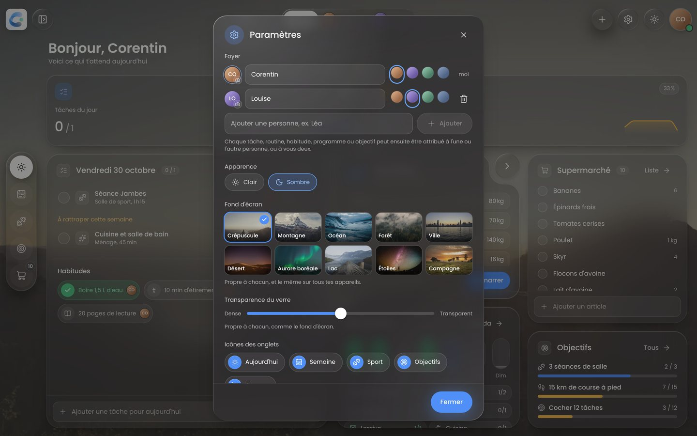 | 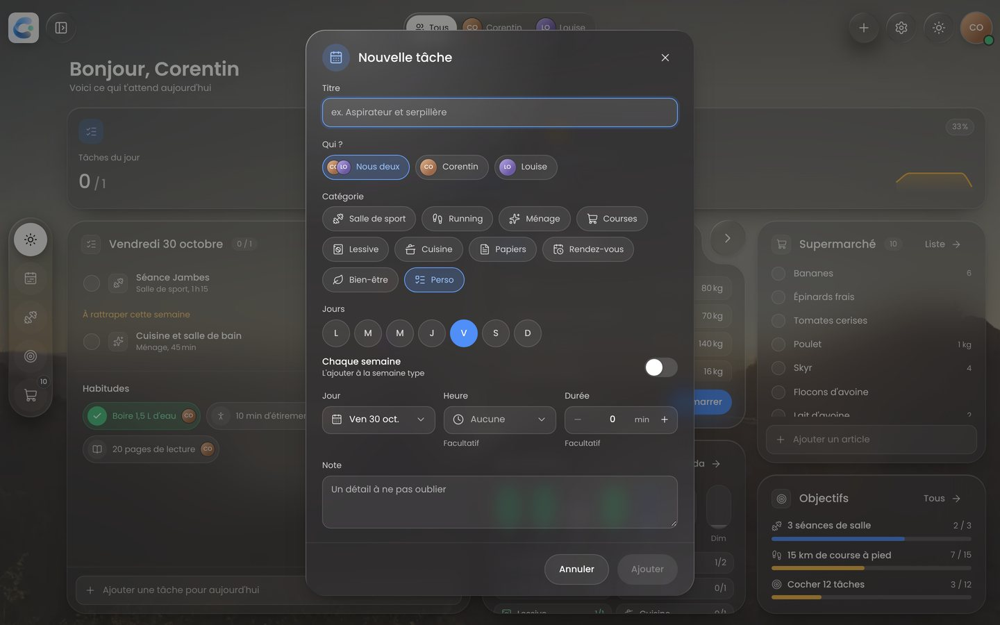 |
| Paramètres : fond d'écran, transparence du verre | Dialogue : verre dense, voile qui fond sur son propre calque |

Téléphone (barre d'onglets flottante, + séparé, grand titre qui se replie en barre compacte) :

| 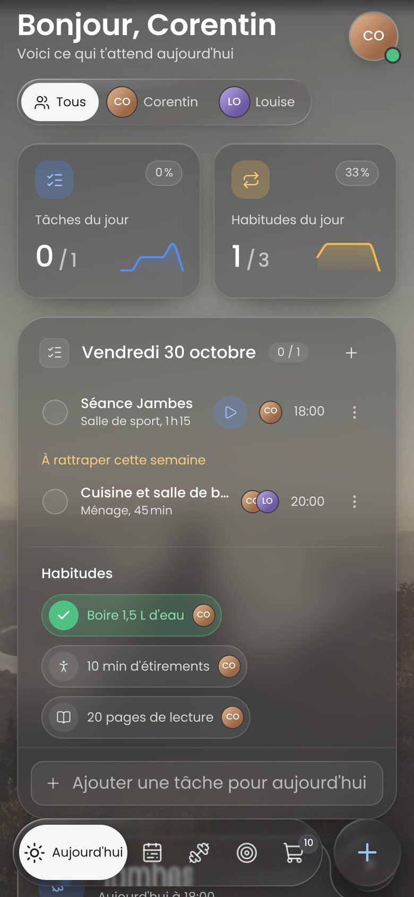 | 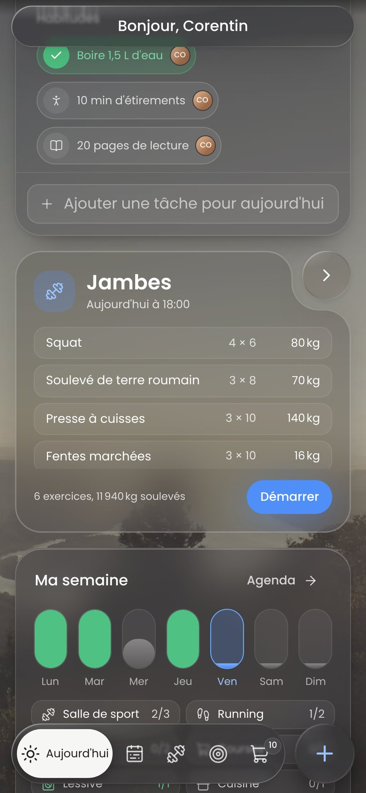 | 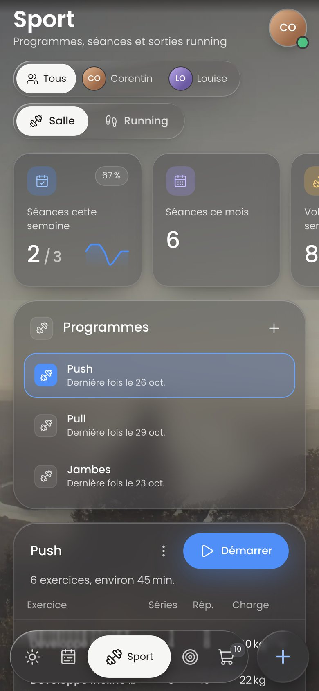 | 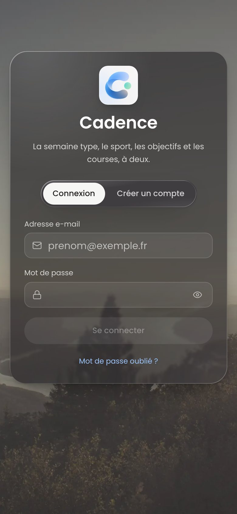 |
|---|---|---|---|

Les ingrédients :
1. **Une photo derrière tout**, adoucie, sous un voile. Sans fond chargé, le verre ne se voit pas.
2. **Trois sortes de verre** : le verre dépoli des panneaux, le verre liquide des contrôles (réfraction SVG sur
   Chromium) et le verre « découpé » qui change de forme (rail, pastilles-menus).
3. **Une seule lumière** : la bulle blanche de la navigation (rail, barre d'onglets, contrôles segmentés, filtre).
4. **Un seul ressort** pour tout ce qui bouge (bulles, rail, menus), joué par Web Animations.
5. **Des fondus portés par chaque pièce**, jamais par un conteneur (sinon le verre perd son flou).

---

## 2. Fichiers à reprendre

| Fichier | Rôle |
|---|---|
| `src/styles/tokens.css` | Tous les jetons : couleurs jour / verre fumé, typo, rayons, ombres, densité du verre, voile du fond |
| `src/styles/app.css` | Utilitaires de verre (`glass-panel`, `.liquid`, `.rail-*`, `.chip-*`), fond photo, fondus d'écran, curseur |
| `src/ui/glass.tsx` | Verre liquide : carte de déplacement + filtre SVG (`useLiquidGlass`), détection WebKit |
| `src/ui/liquid.ts` | Le ressort échantillonné (`SPRING`), `travel`, `follow`, `useLiquidBubble`, `useDeferredPick` |
| `src/ui/navigation.tsx` | Rail (vague, ouverture), `SegmentedControl` |
| `src/ui/chipMenu.tsx` | Pastille qui devient son menu (profil, +) |
| `src/screens/shell/MobileShell.tsx` | Barre d'onglets du téléphone |
| `src/screens/shell/ScreenFrame.tsx` | Transition entre écrans |
| `src/ui/backdrop.tsx` | Fonds d'écran (10 photos) et réglage de transparence |
| `src/ui/charts.tsx` | Cartes KPI, mini-courbes, barres |
| `src/theme/motion.ts` | Préréglages de mouvement (`revealVariants`) |
| `public/backdrop/` | Les photos (4 tailles chacune) |

Bibliothèques : React 19, Tailwind CSS 4, `motion` (Framer Motion), `lucide-react` (icônes, trait 1,75),
`@number-flow/react` (chiffres qui roulent), police **Poppins** 400 / 500 / 600 servie avec l'appli.

---

## 3. Couleurs et matières (thème « verre fumé »)

Le principe : **aucune surface opaque**. Tout est un voile, blanc ou gris neutre, posé sur la photo.

| Jeton | Valeur | Usage |
|---|---|---|
| `--glass-panel` | `rgb(74 74 78 / 0.33)` | Cartes et panneaux (ordinateur) |
| `--glass-panel-mobile` | `rgb(70 70 74 / 0.42)` | Les mêmes au téléphone (texte qui défile dessous) |
| `--glass-bar` | `rgb(52 51 54 / 0.56)` | Barres au-dessus du contenu (onglets, barre compacte) |
| `--glass-panel-strong` | `rgb(48 47 50 / 0.76)` | Dialogues |
| `--glass-liquid` | `rgb(80 79 82 / 0.26)` | Verre clair des contrôles |
| `--glass-blur` / saturation | `30px` / `1.15` | Givre des panneaux (jour : 24 px / 1.7) |
| Liseré | blanc 13 % (bord) + 24 % (reflet en haut) | `--glass-rim-soft`, `--glass-rim-light` |
| Ombre | `0 18px 40px -18px rgb(0 0 0 / .5), 0 2px 8px -2px rgb(0 0 0 / .16)` | `--glass-shadow` |
| Texte | blanc 100 / 76 / 60 % | primaire, secondaire, discret |
| Tuiles internes | blanc 8 à 15 % | `bg-raised`, `bg-hover` |
| Bulle de navigation | `#f6f6f5` **opaque**, encre `#24211e` | `--color-nav-active`, `--color-text-on-nav` |
| Accent | `#4f8ff7`, texte `#9cc4ff` | bouton principal, barre « du moment » |

Le thème clair garde la même photo sous un voile blanc (`--backdrop-veil`), avec des teintes blanches à 55 % et une
bulle bleue.

**Densité réglable** : chaque teinte s'écrit `rgb(r g b / min(0.95, a * var(--glass-k, 1)))`. Le curseur de
Paramètres règle `--glass-k` de ×1,8 (dense) à ×0,55 (transparent), et `--glass-ks` (dialogues, menus) en reçoit la
moitié, pour que les textes restent lisibles. `min(0.95, …)` empêche d'atteindre l'opaque. On ne descend pas sous
×0,55 : le givre ne porterait plus le texte.

| 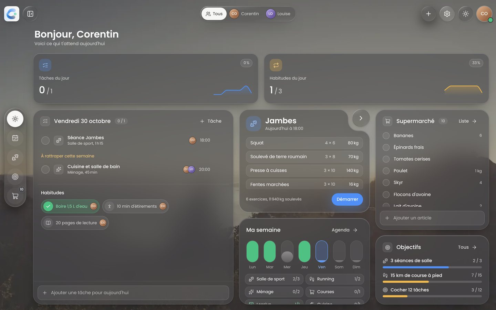 | 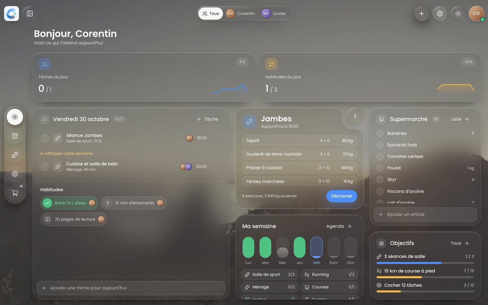 |
|---|---|
| Curseur au plus dense | Curseur au plus transparent |

Rayons : panneaux 28 px, tuiles 16 à 20 px, boutons et bulles ronds, rail 32 px. Typographie : titre de page 28 px
(600), titres de carte 16 px (500), valeurs KPI 28 px (500, chiffres tabulaires).

---

## 4. Le fond photo

|  | 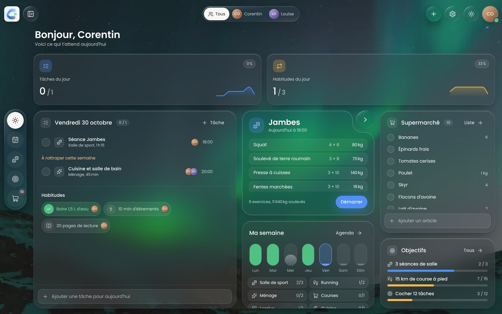 | 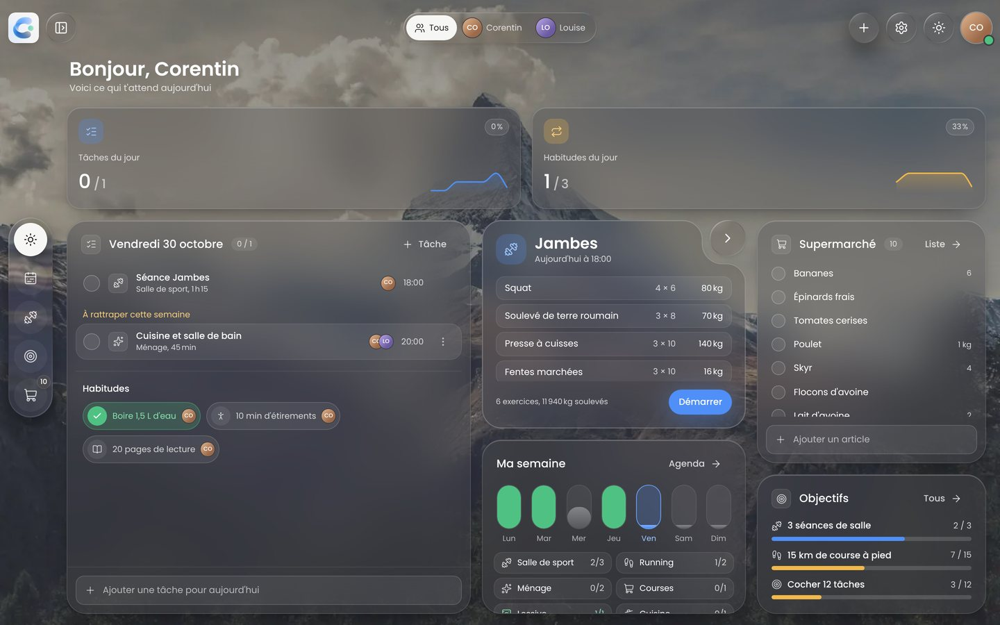 | 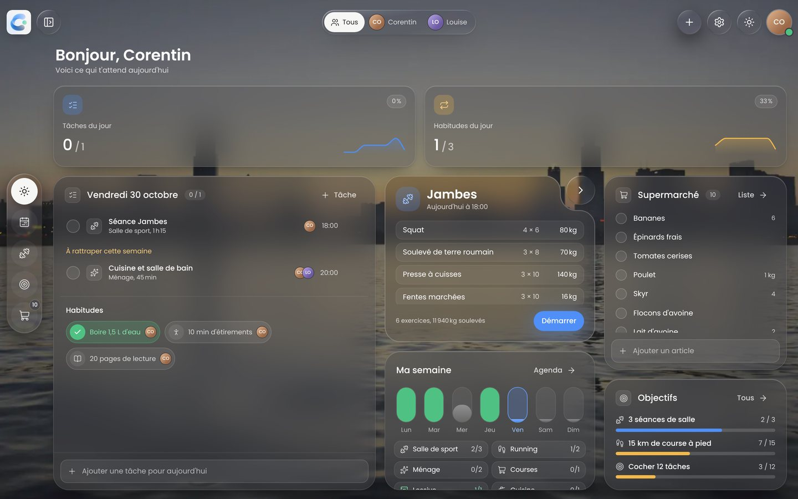 |
|---|---|---|---|

**Traitement de chaque photo** (script Python + Pillow) :
- **Désaturer** : `ImageEnhance.Color(…).enhance(0.72 à 0.9)`. Le verre fumé veut des tons neutres : une photo trop
  colorée teinte tous les panneaux (au premier essai, tout tirait sur le brun).
- **Resserrer les tons** : noirs relevés à 40-50, blancs baissés à 180-185 (table de correspondance par canal, rouge
  +2, bleu −3). Les titres blancs restent lisibles partout, sans zone qui crève.
- **Quatre fichiers WebP** :
  - `wide` 2048 px (qualité 72) ;
  - `mid` 1280 px, sous 1500 px d'écran ;
  - `tall` 900 px de large, recadré en portrait autour d'un point d'intérêt, pour les téléphones ;
  - `thumb` 320 × 200, la vignette du sélecteur.
  - Comptez 30 à 300 Ko par photo selon le détail.
- **Couleur moyenne** de chaque photo en couleur de fond : elle s'affiche le temps du chargement.

**Affichage** : un `div` plein écran (`background: cover`) et un `::after` pour le voile (plus sombre en haut, sous
les titres). Les fichiers sont des variables CSS (`--backdrop-wide`…) posées sur `<html>` : changer de photo ne
redessine rien d'autre.

**Mise en cache** : ne pré-cachez pas les 10 photos (2 Mo). Le service worker garde chaque photo une fois affichée
(`CacheFirst`).

Photos : Unsplash (licence libre), crédits dans `docs/design-system.md`.

---

## 5. Le verre

### 5.1 Panneau dépoli (cartes)
```css
.glass-panel {
  background: var(--glass-panel);
  border: 1px solid var(--glass-rim-soft);
  box-shadow: var(--glass-shadow), inset 0 1px 0 var(--glass-rim-light);
  backdrop-filter: blur(var(--glass-blur)) saturate(var(--glass-saturate));
}
```
Au téléphone : un peu plus dense, flou 16 px (le défilement reste fluide dans Safari). Repli opaque
(`--glass-solid`) sans `backdrop-filter` ou avec « transparence réduite ».

### 5.2 Verre liquide (contrôles : boutons ronds, segmentés, barre d'onglets, filtre)
Une **carte de déplacement** est dessinée pour le rectangle arrondi de l'élément : chaque pixel est décalé vers
l'intérieur près du bord (R = décalage x, G = décalage y, 128 = rien), selon `(1 − profondeur/biseau)^2.2`. Elle est
appliquée par un filtre SVG `feGaussianBlur → feDisplacementMap → feColorMatrix saturate`, posé en
`backdrop-filter: url(#filtre)`. Le fond se courbe au bord comme à travers une lentille épaisse.
- La carte est calculée à demi-résolution, gardée en cache par taille (48 filtres au plus), et refaite par un
  `ResizeObserver`.
- Réglages (biseau / force) : rail 26 / 18, barre d'onglets 20 / 14, dialogue 24 / 18 (flou 10), carte à encoche
  18 / 12, segmentés et filtre 12 / 8, pastilles-menus 14 / 9 (flou 3).
- Par-dessus la réfraction : un reflet (`::before`, dégradés radiaux en `soft-light`) et un liseré (`::after`, anneau
  en dégradé à 140°, clair en haut à gauche, reflet en bas à droite, tracé par masque `xor`).
- **Chromium uniquement** : Safari ignore `url()` dans `backdrop-filter`. Ailleurs, le même élément garde un
  givre CSS plus dense (flou 18 px, saturation 2).

### 5.3 Verre qui change de forme (rail, pastilles-menus)
Un calque **plus grand** que la forme (le rail ouvert, ou la pastille + son menu), découpé par un `clip-path: path()`
recalculé à chaque image de l'animation. Ombre, liseré et teinte du menu sont d'autres calques découpés par le
**même** tracé :
- l'ombre : une copie floutée, découpée à l'extérieur du contour (`path(evenodd, 'grand rectangle + contour')`) ;
- le liseré : un anneau entre le contour et le contour décalé de 1 à 1,5 px (`path(evenodd, contour + contour
  intérieur)`).

Tous ces tracés sont calculés ensemble, 60 fois par seconde, pour les mêmes images-clés : rien ne peut se décaler.
Un `d` SVG animé à part laissait voir une tache noire en route.

---

## 6. Le mouvement

### 6.1 Le ressort unique
```ts
// raideur 380, amortissement 24 (ζ ≈ 0,62) : dépasse de 7,7 % puis se pose, en 567 ms
const k = 380, c = 24, dt = 1 / 240;
let p = 0, v = 0; const frames = [{ p: 0, v: 0 }];
for (let i = 1; i < 360; i++) {
  v += (-k * (p - 1) - c * v) * dt; p += v * dt;
  if (i % 4 === 0) frames.push({ p, v });            // une image-clé par 1/60 s
  if (Math.abs(p - 1) < 0.0015 && Math.abs(v) < 0.02 && i % 4 === 0) break;
}
frames.push({ p: 1, v: 0 });
```
On calcule le ressort une fois, on en tire des images-clés, et **Web Animations** les joue (`el.animate(frames,
{ duration, easing: 'linear' })`) sur le compositeur. La bulle continue donc d'avancer pendant que React dessine
l'écran suivant. Pour le rail et les pastilles, on garde la moitié du dépassement (`1 + (p − 1) / 2`) : la page
bouge avec eux.

### 6.2 La bulle qui voyage
- Elle **s'étire dans le sens du déplacement** et s'amincit en travers, proportionnellement à la vitesse :
  `étirement = min(0,15, |distance × vitesse| / 6000)`, travers `1 − étirement × 0,45`.
- Sur la première ou la dernière entrée, le dépassement la porterait hors du verre : le verre de la barre s'étire
  avec elle (`follow()`). Ce verre est un **calque derrière la bulle**, pas le conteneur, sinon son liseré barrerait
  la bulle.
- **Le changement part deux images après le clic** (`useDeferredPick` : la bulle part tout de suite, l'écran lourd
  ensuite). Sans ce décalage, le rendu du nouvel écran figeait la bulle au départ.
- Ne pas utiliser `layout` / `layoutId` de Motion pour ces bulles : ils mesurent toute la barre à chaque rendu et se
  figent pendant le rendu du nouvel écran.

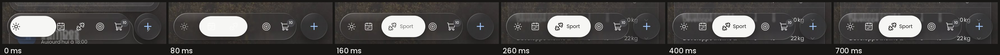

### 6.3 Le rail : vague liquide
Rail replié : à mi-chemin du trajet de la bulle, le nom **coule hors du rail** dans une seconde bulle, et le verre
du rail se gonfle en vague autour d'elle. La vague tient 1,1 s, puis reflue en 300 ms.

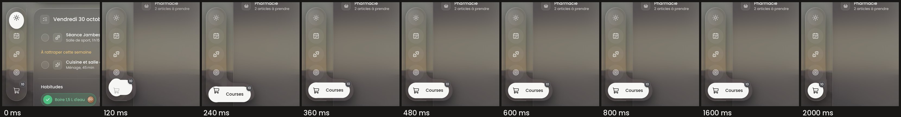

Les réglages :
- la bulle du nom dépasse de 14 px, cachés, pour que son ressort puisse rebondir sans laisser de vide ;
- le verre garde 12 px autour d'elle ;
- les creux qui la raccordent au rail mesurent 26 px.

Comportement :
- Plus le nom coule vite, plus il s'amincit (jusqu'à −16 %). Le halo de la bulle ronde s'éteint pendant que le nom
  est sorti : une seule lumière.
- Sur le premier et le dernier onglet, la vague **rejoint le haut ou le bas du rail** au lieu de déborder (son coin
  est celui du rail). Près des coins, ses creux rétrécissent.
- Le badge (10 articles) **suit la fin du nom sorti**, comme il se tient sur l'icône quand rien ne sort.
- Au survol d'un autre onglet, le rail replié montre son nom dans une petite étiquette sombre.
- Ouvert (icônes et noms), le rail n'a pas de vague. Sa largeur suit le même ressort (moitié du rebond) et la page
  suit.

| 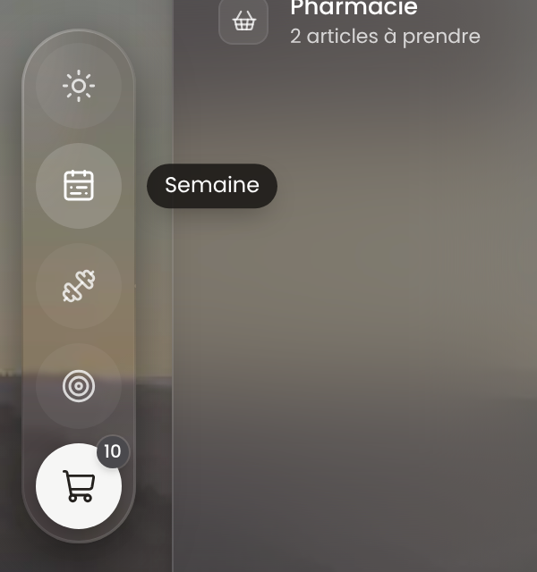 | 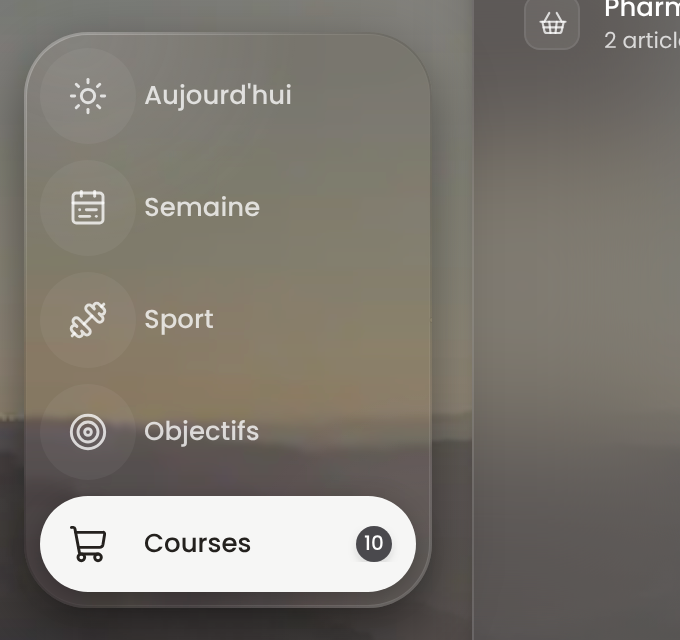 |
|---|---|

### 6.4 La pastille qui devient son menu (profil, +)
Le cercle de la pastille **descend** dans le menu (vers le haut au téléphone), puis s'élargit, raccordé par un creux
arrondi. Ouverture sur le ressort, fermeture en 300 ms (courbe douce).

Géométrie :
- 6 px entre la pastille et le menu ;
- coins du menu à 16 px, creux à 14 px ;
- le menu commence à s'élargir quand le ressort atteint 60 %. Avant, il garde la largeur de la pastille : sinon un
  angle vif apparaissait au raccord.

Comportement :
- Les entrées apparaissent quand le verre est presque ouvert (sur le plus loin qu'il est allé, pour que le rebond ne
  les fasse pas clignoter). À la fermeture, elles partent dans les 90 premières ms.
- Le + tourne en × (135°, 500 ms, courbe `cubic-bezier(0.34, 1.56, 0.64, 1)` qui dépasse un peu).
- Ouvert, reflet, liseré et teinte **couvrent toute la forme**. Laissés sur la seule pastille, ils dessinaient un
  rond visible dans le menu.
- La pastille du profil n'a **pas de verre au repos** (l'avatar est opaque) : le verre sort de la photo à l'ouverture.

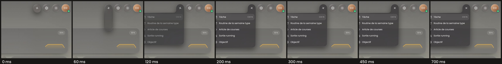
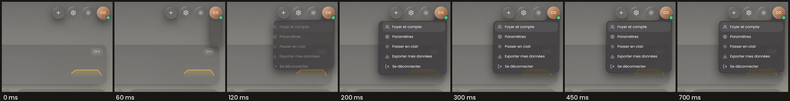
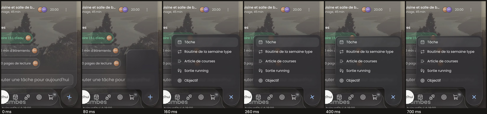

### 6.5 Les autres panneaux (listes, sélecteurs de date et d'heure)
Ils **naissent de leur bouton** :
- une mise à l'échelle sur le même ressort, depuis une goutte de la largeur du bouton (16 % de haut) ;
- le contenu fond après 22 % du trajet ;
- retour vers le bouton en 200 ms.

Pas de réfraction SVG ici : refiltrer le fond à chaque image saccadait le calendrier.

### 6.6 Changer d'écran
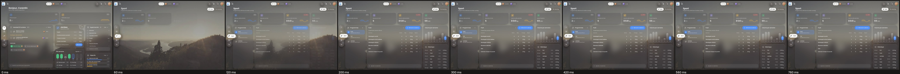

- **Sortie** : l'ancien écran glisse de 6 px vers le haut, ses pièces fondent en 140 ms.
- **Entrée** : le nouveau glisse de 10 px vers le bas jusqu'à sa place (400 ms), ses pièces fondent en 416 ms,
  **en cascade** (60 ms par carte, retard posé en variable CSS `--ri` par `revealVariants`).
- **Ce qui fond** : chaque surface de verre, les titres, les boutons d'en-tête. Chacun fond lui-même, jamais un
  conteneur (voir le piège 1). Une animation CSS joue à l'insertion de l'élément, donc aussi pour une vue qui apparaît
  (Salle / Running).
- Le filtre des personnes de la barre du haut **reste en place** sur Courses et s'efface (chaque pièce fond et se
  réduit à 94 %), au lieu de disparaître d'un coup.

### 6.7 Les durées
| | |
|---|---|
| Courte (sortie, survol) | 140 ms, `cubic-bezier(0.4, 0, 1, 1)` |
| Moyenne (entrée) | 320 ms, `cubic-bezier(0.2, 0.9, 0.25, 1)` |
| Longue (courbes, barres) | 620 ms, `cubic-bezier(0.16, 1, 0.3, 1)` |
| Décalage entre cartes | 60 ms |
| Ressort | 567 ms, dépassement 7,7 % |
| Vague : tenue, reflux | 1100 ms, 300 ms |
| Fermeture d'une pastille-menu | 300 ms |
| Rotation du + | 500 ms |

Toutes les durées se réduisent avec « réduire les animations » (pas de glissement, pas de fondu).

---

## 7. Les composants

- **Barre du haut** (ordinateur) : logo, bouton du rail ; au centre le filtre des personnes ; à droite +,
  Paramètres, thème, avatar avec point de synchro (vert à jour, bleu qui respire en envoi, ambre hors ligne). Ce sont
  des boutons ronds de verre de 44 px.
  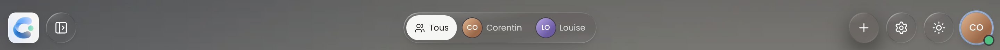
- **Rail** : pilule fine de 64 px (ouverte : 204 px), centrée verticalement, les seuls cinq onglets. Chaque icône
  est dans un rond à 5 % de blanc.
- **Titre de page** : nom du menu + une ligne de sous-titre. Aujourd'hui salue (« Bonjour, Corentin »,
  « Bonsoir » dès 18 h). Pas d'ombre sous les titres : au téléphone, elle les rendait flous.
- **Carte KPI** :
  - en haut, un carré d'icône teinté (accent, ambre, vert, violet, à 25 %) et une pastille d'évolution (vert ↗,
    rouge ↘, gris) ;
  - puis le libellé ;
  - enfin la valeur, aux chiffres qui roulent, avec à côté une mini-courbe des dernières périodes (dégradé vers le
    bas, tracé qui se dessine).

  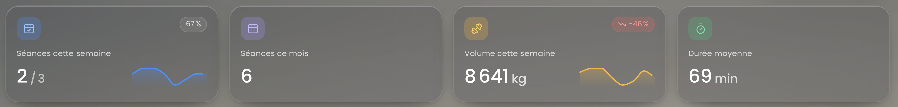
- **Barres** : des voiles de verre en dégradé ; seule la barre « du moment » est bleue et lumineuse.
- **Badges** : opaques (`--badge-bg`), avec un fin anneau. Translucides, ils disparaissaient sur la bulle blanche.
- **Avatars** : le bord est un **anneau en `box-shadow`** autour de l'image. Une bordure translucide posée sur
  l'image faisait un cercle flou.
- **Curseur** : `input type="range"` restylé, piste de 6 px remplie en bleu jusqu'à la valeur (`--fill`), bouton
  blanc de 24 px, 44 px de haut au doigt. Il applique en direct et n'enregistre qu'après 400 ms de repos (pas une
  synchronisation par pixel).
- **Menus et dialogues** : voile sombre (`--glass-panel-strong`). Le voile de fond du dialogue fond **sur son propre
  calque**, à côté du panneau, jamais autour.

---

## 8. Pièges et leçons (le plus important)

### Le verre
1. **Un parent avec `opacity < 1`, `filter`, `mask` ou `clip-path` coupe le flou de ses descendants** (il devient
   « racine de fond »). Le verre ne voit plus la page derrière : il paraît clair, puis givré d'un coup à la fin du
   fondu. Donc **jamais de fondu sur un conteneur de verre** : faites fondre chaque élément de verre lui-même (son
   propre `opacity` est sans danger) et glissez les conteneurs (`transform` est sans danger).
2. **Safari (WebKit) ne découpe pas un `backdrop-filter` par un `clip-path`** : un calque découpé montre toute sa
   boîte givrée, un « carré discret » autour du menu. Là, le givre vient de **boîtes arrondies** (`border-radius`)
   qui suivent la forme ; la teinte et le liseré gardent leur `clip-path` (peinture simple, bien découpée).
3. **Safari floute aussi toute la boîte d'un calque `filter: blur()` dont l'enfant a un `clip-path`** : ombre
   carrée. Là, l'ombre devient le `box-shadow` de boîtes arrondies, dans un calque découpé à l'extérieur du contour.
4. **Une ombre unique aux bornes d'une forme non rectangulaire dessine ces bornes** : une traîne rectangulaire à côté
   de la pastille. Il faut des pièces qui suivent la vraie forme (colonne + menu).
5. **Détectez le moteur, pas le nom du navigateur** : Chrome sur iPad se présente comme un Chrome de Mac, mais c'est
   WebKit, comme tout sur iOS. Testez `navigator.vendor` qui commence par « Apple », ou
   `CSS.supports('-webkit-touch-callout', 'none')`.
6. **Chromium ne montre aucun défaut WebKit**, même avec un user-agent d'iPhone : une capture Chrome ne prouve rien
   pour Safari. Installez le vrai WebKit de Playwright à part
   (`PLAYWRIGHT_BROWSERS_PATH=<dossier> npx playwright install webkit`, puis `install-deps webkit`) et comparez des
   captures fermé / ouvert pixel par pixel. Cela a trouvé ce que l'œil ne voyait pas. Son WebKit Linux ne rend pas
   le flou, mais reproduit les problèmes de découpe.
7. **Réfraction SVG = coûteuse** : à chaque image d'une animation, elle saccade. Pendant le mouvement, remplacez-la
   par le même givre en CSS (`paused`), et n'en mettez pas sur les panneaux qui grandissent.

### Les couleurs
8. **Deux blancs translucides superposés ne font pas le même blanc** : là où la bulle ronde et le nom sorti se
   chevauchaient, le rond se voyait. Les bulles sont **opaques**.
9. **Badges et anneaux translucides disparaissent** sur la bulle blanche ou rendent les cercles flous : opaques,
   ou anneau en `box-shadow`.
10. **Un champ rempli par le navigateur** (e-mail enregistré) prend un rectangle bleu pâle forcé en `!important`.
    Parade : `-webkit-text-fill-color` et une transition de 600000 s sur `background-color`, dans deux règles
    séparées pour `:-webkit-autofill` et `:autofill` (un navigateur qui ignore l'un des deux sélecteurs jette toute
    la liste).

### La mise en page et le téléphone
11. **Un élément `fixed` dans un parent animé (`transform`) est piégé** : barre compacte, minuteur, etc. vont dans
    `<body>` (portail).
12. **Barre d'état de l'iPhone** : `apple-mobile-web-app-status-bar-style = black-translucent`, l'appli dessine
    dessous (avec un léger dégradé sombre pour l'heure). Le style `default` donnait un bandeau uni flou. Changer ce
    réglage demande parfois de réinstaller l'appli sur l'écran d'accueil.
13. Champs en **16 px minimum** au téléphone, sinon iOS zoome ; `user-select: none` sur écran tactile (sauf champs),
    sinon un appui long sélectionne le texte.

### La mise en ligne
14. **Ne pré-cachez pas la page** dans le service worker : une ouverture montrait l'ancienne version jusqu'au
    rechargement suivant (les anciens fonds réapparaissaient). La page passe en **réseau d'abord**
    (`NetworkFirst`), et sa copie ne sert qu'hors ligne.
15. **Navigateurs et favoris gardent une icône par adresse**, longtemps. Changer le contenu de `logo.svg` ne suffit
    pas, et le supprimer est pire : l'adresse renvoie la page, le favori garde l'ancien logo. Servez le nouveau logo
    sous de **nouvelles adresses**, et aussi aux anciennes.
16. **Un commentaire CSS fermé trop tôt casse toute la feuille sans bruit** : le serveur de développement continue
    de servir l'ancienne. Après une modification de CSS, lancez `npm run build`, qui, lui, échoue.

### L'animation
17. Le changement d'écran doit partir **deux images après le clic** : la bulle part, puis l'écran lourd se dessine.
18. Pour figer une animation en images, ralentissez tout le navigateur
    (`Animation.setPlaybackRate(0.1)` par Chrome DevTools) au lieu d'enchaîner des captures, trop lentes pour
    tomber au bon moment.
19. Une forme qui sort d'un bord (vague, menu) doit prévoir **les extrémités** : premier et dernier élément, bord de
    l'écran, rebond du ressort au-delà de la cible.

---

## 9. Pour vérifier un nouveau projet dans ce style
1. Captures sur 8 tailles, clair et sombre (`scripts/shoot.ts`) : débordements, textes coupés, cibles trop petites,
   erreurs console.
2. Les menus et formes découpées dans le **vrai WebKit**, fermé / ouvert, avec une différence de pixels.
3. Une séquence ralentie ×10 de chaque animation : bulle, vague, menu, changement d'écran.
4. Le réglage de transparence aux deux bornes : les dialogues restent lisibles.
5. Hors ligne après une visite : l'appli s'ouvre. En ligne : toujours la dernière version.

## 10. Ressources
- Référence visuelle : la vidéo « Glassy Dashboard V5 » (verre fumé, barre à pastilles, rail fin).
- Photos : Unsplash. Crédits et identifiants des 10 fonds dans `docs/design-system.md`.
- Police : Poppins (`@fontsource/poppins`, latin, woff2). Icônes : Lucide.
- Web Animations API (MDN), `backdrop-filter` (MDN), `feDisplacementMap` (MDN). Workbox (`NetworkFirst`,
  `CacheFirst`) via `vite-plugin-pwa`. Playwright (`chromium`, `webkit`, CDP `Animation.setPlaybackRate`).
